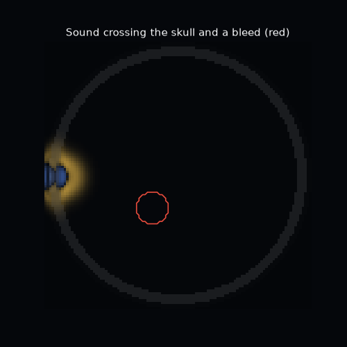
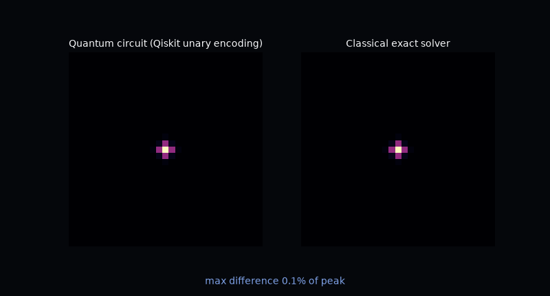
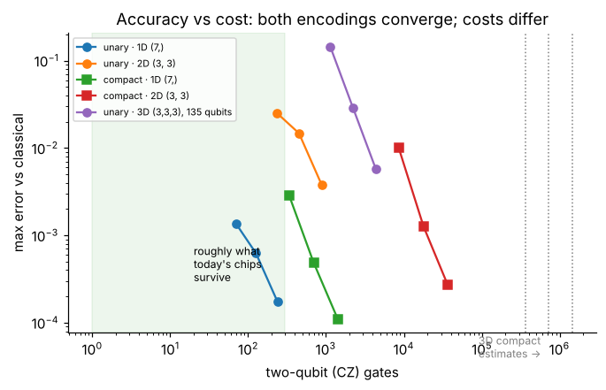
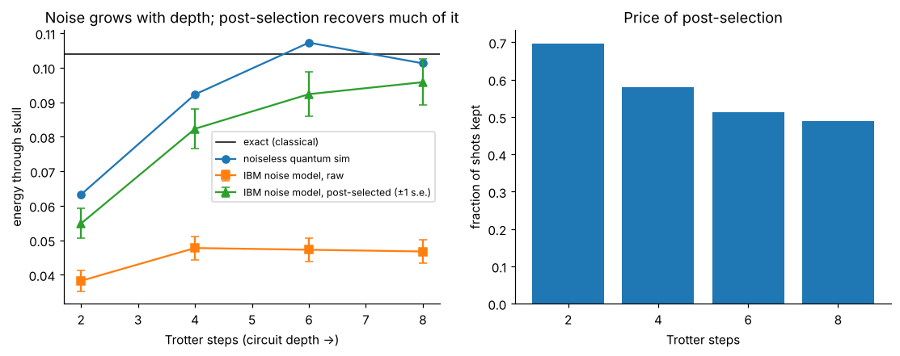
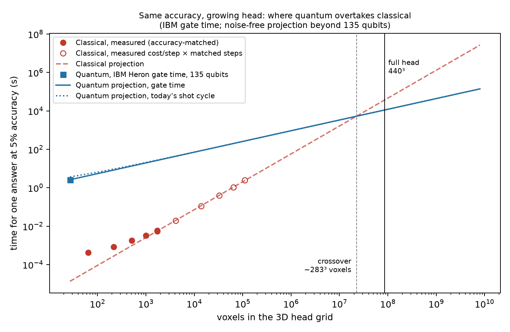
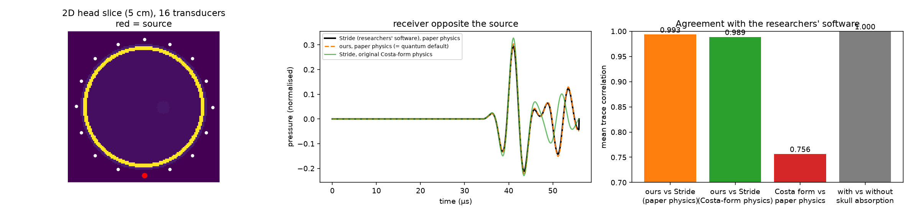
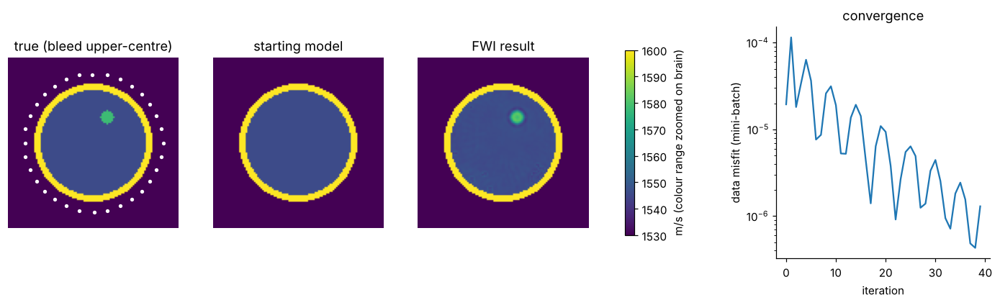

<div align="center">

# Aperion: can a quantum computer see a brain bleed?

**Quantum wave simulation for portable stroke imaging · Qiskit Fall Fest 2026**



*Ultrasound crossing a 2D head slice: water, scalp, skull, brain and a bleed (red). Simulated with this repo's solver.*

`Qiskit 2.x` · `Aer` · `IBM Runtime SamplerV2` · `ibm_marrakesh (156-qubit Heron)` · `error mitigation` · `37 tests`

</div>

---

## In one paragraph

A stroke caused by bleeding has to be told apart from a clot **before** treatment, and that takes a CT/MRI scanner most
ambulances and rural hospitals don't have. Guasch et al. (*npj Digital Medicine*, 2020) showed a helmet of ultrasound
transducers can image the brain with **full-waveform inversion (FWI)**, but reconstruction needs thousands of wave
simulations, and **over 95% of the compute is the wave simulation itself**. We turned that wave simulation into
**quantum circuits**. We proved they reproduce the physics in 1D, 2D and 3D, validated our solver against the paper
group's own software, **ran it on a real IBM quantum computer** with error mitigation, and measured where quantum
overtakes classical as the head grid grows.

## Headline results

| | Result | Where |
|---|---|---|
| ⚛️ **Real quantum hardware** | `ibm_marrakesh`, job `db9smd9gv2cc73e60pm0`, 6 circuits × 4,000 shots, 9 s of QPU. Exact answer **0.104**. Raw chip 0.013, **post-selected 0.081 ± 0.011** | [§ Hardware](#-real-ibm-quantum-hardware) |
| ⚡ **Gate speed, measured** | One run of the circuit on IBM Heron: **6.3 µs**. Classical solve of the same problem: **695 µs** (**~110× per run**) | [§ Speed](#-speed-where-quantum-overtakes-classical) |
| 📈 **Crossover, measured + projected** | At equal 5% accuracy, quantum overtakes classical at **~283³ voxels**; **~3.3× faster at a full 440³ head** | [§ Speed](#-speed-where-quantum-overtakes-classical) |
| ✅ **Quantum = physics** | Circuits match the classical wave in 1D, 2D and **3D (135 qubits)**; the 2,945-qubit 2D animation below stays within 1.5% | [§ Correctness](#-the-quantum-circuit-computes-the-same-wave) |
| 🎯 **Validated vs the researchers' software** | Our solver vs Stride (the paper group's code): **0.993** trace correlation | [§ Validation](#-validation-against-stride) |
| 🧠 **Finds the bleed** | Classical FWI recovers the bleed: **1,576 m/s vs true 1,578** | [§ Imaging](#-imaging-the-bleed-fwi) |
| 🔬 **Five-way method comparison** | Gate ideal 0.58% · SQA 1.55% · SA 1.58% · gate + noise 8.9% error | [§ Pilot](#-pilot-five-methods-on-the-same-wave) |
| 🛠️ **Engineering** | Noisy simulator rewritten: **~150× faster** (55 min → 21 s), bit-identical output | [§ Companion](#-companion-team-pipeline) |

---

## 🌊 The idea in 30 seconds

```
   transducer helmet          wave simulation (95% of compute)          image
  ┌───────────────┐        ┌──────────────────────────────────┐      ┌────────┐
  │ record echoes │ ─────► │  guess head → simulate → compare │ ───► │ bleed? │
  └───────────────┘        │        ▲                 │       │      └────────┘
                           │        └── update guess ─┘       │
                           │   ⚛️  this step on a QPU          │
                           └──────────────────────────────────┘
```

The acoustic wave equation `p_tt = c² ∇² p` can be rewritten as a Schrödinger equation `i ψ_t = H ψ` with a
Hermitian `H` (Costa et al. 2019). Quantum computers natively run `exp(-iHt)`, so one Trotterised circuit
simulates sound moving through the head. We built two encodings:

| Encoding | Qubits | Gates | Use |
|---|---|---|---|
| **Unary** (one qubit per cell/link) | cells + links | small, local, all gates in a layer run in parallel | Run on real hardware; time per step is set by circuit depth, not grid size (given grid-connected qubits) |
| **Compact** (binary index) | log₂(cells + links): **29 qubits for the full head** | ~40× more in 2D | The memory-advantage route, for fault-tolerant hardware |

## ✅ The quantum circuit computes the same wave

<div align="center">

</div>

Left: the output of our **Qiskit unary circuit** for a 31 × 31 head slice, a **2,945-qubit** circuit. It's replayed exactly
in its single-excitation subspace (`test_subspace_replay_equals_circuit` proves the replay equals the gate-level circuit),
because no simulator can hold 2,945 qubits otherwise. Right: the exact classical solution. Same head, same source, same
time. The difference stays below 1.5% of the peak.

The test suite (`pytest -q`, 37 checks, ~30 s) proves this formally:

| Test | What it proves |
|---|---|
| `test_energy_conserved`, `test_exact_matches_finite_difference` | Two independent classical solvers agree to ~1e-7; energy conserved |
| `test_paper_form_is_the_papers_equation` | The quantum Hamiltonian encodes exactly the paper's equation `p_tt = c²∇²p` |
| `test_unary_hamiltonian_equals_wave_hamiltonian_in_subspace` | The qubit Hamiltonian *is* the wave equation |
| `test_compact_circuit_matches_classical`, `test_unary_circuit_matches_classical` | Gate-level circuits reproduce the wave in 1D, 2D and **3D (135 qubits)** |
| `test_subspace_replay_equals_circuit` | The fast subspace replay equals the gate-level circuit, so big-grid results are the circuit's |
| `test_trotter_error_shrinks_with_steps` | Error converges as circuits get deeper |
| `test_light_cone_truncation_is_valid` | The 9-qubit hardware circuit is exact to < 0.001 |
| `test_readout_correction_recovers_true_distribution` | Readout-error correction is right |
| `test_fwi_gradient_points_toward_bleed`, `test_hybrid_exact_misfit_finds_bleed` | The inversion finds the bleed |



## 💻 Real IBM quantum hardware

**Backend** `ibm_marrakesh` (156-qubit Heron r2) · **Job** `db9smd9gv2cc73e60pm0` · **Date** 2026-10-17 ·
**Circuit** the ear-to-ear line through the 3D head, 15 qubits, t = 1.5 · **Settings** SamplerV2 in Batch mode,
4,000 shots, dynamical decoupling and gate/measurement twirling, opt. level 3 · **QPU used** 9 s of 600 s free

| Circuit | Ideal (Aer) | Noise model (FakeKingston), post-selected | **Hardware raw** | **Hardware post-selected** | Shots kept, sim → chip |
|---|---|---|---|---|---|
| 2 Trotter steps | 0.063 | 0.055 ± 0.004 | 0.019 | **0.055 ± 0.006** | 70% → 34% |
| 4 steps | 0.092 | 0.082 ± 0.006 | 0.017 | **0.077 ± 0.009** | 58% → 22% |
| 6 steps | 0.107 | 0.092 ± 0.006 | 0.016 | **0.090 ± 0.011** | 51% → 18% |
| 8 steps | 0.101 | 0.096 ± 0.007 | 0.013 | **0.081 ± 0.011** | 49% → 16% |
| 8 steps, folded ×3 (ZNE) | 0.101 | 0.082 ± 0.009 | 0.001 | 0.083 ± 0.036 | 21% → 1.5% |
| 8 steps, **bleed** | 0.102 | 0.091 ± 0.007 | 0.013 | 0.091 ± 0.012 | 49% → 15% |

**Error mitigation stack:**
- **Suppression:** dynamical decoupling and Pauli twirling.
- **Post-selection:** the physics conserves the excitation number, so any shot that doesn't show exactly one excitation is known to be bad and is dropped.
- **Zero-noise extrapolation:** unitary folding ×1 and ×3.

**What we learned:**
1. Raw hardware keeps only ~13% of the signal. **Post-selection recovers every point to within 2σ** of the ideal circuit.
2. The real chip keeps ~3× fewer shots than its noise model predicts (16% vs 49%), which is useful calibration for anyone modelling Heron noise.
3. Post-selection + ZNE gives 0.080 ± 0.024 (within 1 SE of exact). The ×3 circuit keeps only 1.5% of shots, so ZNE mostly widens the error bar; post-selection does the work.
4. The bleed is **not** detectable at this size and time: its true effect is 0.00005, about 100× below the error bar.

Raw counts, job metadata and measured QPU usage are in [`project/handoff/3_ibm_job/`](project/handoff/3_ibm_job/).
The submission script is [`hardware/run_notebook03_hw.py`](hardware/run_notebook03_hw.py).



## ⚡ Speed: where quantum overtakes classical

### Per circuit run (measured)

| | Time |
|---|---|
| One run of the 8-step circuit on IBM Heron: gates + readout (238 CZ, depth 130, IBM target durations) | **6.3 µs** |
| Classical exact solve of the same problem (best of 200, laptop) | **695 µs** |
| Measured on `ibm_marrakesh` including today's reset delay between shots (6.62 s / 24,000 shots) | 276 µs |

One quantum circuit run is **~110× faster** than the classical solve. One shot gives one outcome, though, and the
answer above used 4,000 shots. At this tiny size, classical still wins on the full answer. The question that
matters is what happens as the head gets bigger.

### Crossover as the head grows

<div align="center"></div>

Both sides answer the **same question at the same accuracy**: energy in every cell after the wave crosses a 3D head,
within 5% of exact. Each side's step count is tuned to just meet that.

| Measured | Classical (finite differences) | Quantum (unary circuit) |
|---|---|---|
| Steps needed at 5%, n = 4 → 12 cells per side | 44 → 198 (∝ n^1.47) | 26 → 136 (∝ n^1.67) |
| Cost of one step | ∝ voxels^0.96: every voxel updated, timed up to 48³ | 23 µs at 2³ and **41.8 µs at 3³ (135 qubits)**, compiled for Heron. All gates in a layer run in parallel, so on grid-connected hardware this stays flat; the projection holds it at 41.8 µs |
| Overall scaling | ∝ voxels^1.45 (measured) | ∝ voxels^0.56 (projected) |

**Crossover at ~283³ voxels (2.3 × 10⁷). At the full 440³ head: ~10.2 h classical vs ~3.1 h quantum, ~3.3× faster.**

**Assumptions** (also in [`results/07_crossover.json`](results/07_crossover.json)):
- Beyond 135 qubits this is a projection. The unary encoding needs ~4 qubits per voxel, and per-step time is held at the measured 3³ value, which assumes hardware whose connectivity matches the grid.
- The projection is noise-free. Today's chips lose most of the signal (above).
- The quantum cost counts one 4,000-shot circuit. Reading out many receivers and times needs more circuits (the readout wall, below).
- Classical is our numpy solver on one laptop core, not an optimised GPU code.

**Takeaway:** quantum advantage here isn't available *today*, because qubits are scarce, noisy and expensive. It is
a question of **scale**. As quantum hardware grows and gets cheaper, the curve above moves in our favour, because
classical cost grows with every voxel while the quantum time per step is set by circuit depth, not grid size.

Reproduce: `PYTHONPATH=. python scaling/crossover.py` (~3 min, no QPU).

## 🎯 Validation against Stride

`validation/compare_stride.py` runs the same 2D head slice (5 cm, 0.5 mm grid, 16 transducers, 200 kHz) through
[Stride](https://github.com/trustimaging/stride), the open-source ultrasound software from the paper's group, and
through our solver.

| Comparison | Mean trace correlation |
|---|---|
| Our solver vs Stride, paper physics (`p_tt = c²∇²p`) | **0.993** |
| Our Costa-form solver vs Stride with matching density | 0.989 |
| Original Costa-form vs paper physics | 0.756, a different medium, so we switched the encoding to the paper form |
| Stride with vs without skull absorption | 0.9997: absorption (which unitary evolution omits) changes signals by ~2% |



## 🧠 Imaging the bleed (FWI)

Classical FWI on a 104 × 104 slice with 32 transducers and 40 rounds recovers the bleed: **1,576 m/s vs true 1,578**
(brain 1,546 vs 1,546; misfit 1.9×10⁻⁵ → 1.3×10⁻⁶). The quantum route plugs in as the forward solver. The
hybrid quantum-misfit search also locates the bleed (notebook 05), but it needs 10¹⁰ shots per circuit for 50% accuracy and 10¹¹ for 95%,
which is decades of QPU time today. That's the readout wall below.



## 🔬 Pilot: five methods on the same wave

Run on the team pipeline ([`companion/`](companion/IBM_Qiskit_Hackathon/)): same 1D forward wave, 8,192 shots,
3 repeats each, target ≤ 1% relative L2 error.

| Method | Relative L2 error | Time per forward run |
|---|---|---|
| Classical exact | ~1×10⁻¹⁶ | 0.002 s |
| **Gate circuit, ideal** | **0.58%** (Trotter 0.15% + shot noise) | 0.12 s (simulated) |
| Simulated quantum annealing (SQA) | 1.55% | 1.89 s |
| Simulated annealing (SA, classical control) | 1.58% | 0.19 s |
| Gate circuit + 0.1% depolarizing noise | 8.85% | 0.17 s |

The gate model beats both annealing approaches on accuracy. Quantum annealing matches classical annealing, so we
chose the gate model. Small noise (0.1%) costs ~9%, which is why mitigation matters.

**Inversions (gate simulator inside the reconstruction loop):**

| Config | Truth | Classical | Gate, ideal | Gate, noisy |
|---|---|---|---|---|
| `small_1d` | [1.00, 1.10] | [0.992, 1.045] | [0.999, 1.045] | [0.995, 0.964] |
| `pulse_1d` | [1.00, 1.10] | [0.998, 1.015] | [1.000, 1.001] | [1.000, 0.979] |

The ideal quantum forward solver tracks the classical one step for step; noise pulls the estimate the wrong way.

## 🧱 Honest limits (and what it would take)

| Limit | Number | What fixes it |
|---|---|---|
| Noise | Raw hardware keeps 13% of the signal | Error correction; until then, post-selection |
| Qubits | Unary full head: ~3×10⁸ qubits. Compact: 29 qubits but ~10¹³ CZ | Fault-tolerant hardware; block-encoded compact circuits |
| Readout wall | One full FWI round by sampling: ~10¹³ shots (~114 years at today's rate) | Clinical questions that need only a few numbers out (e.g. "is there a bleed here?") |
| Physics | Unitary evolution has no absorption (~2% signal effect) | Non-unitary / dilation methods |

See [`LIMITATIONS.md`](LIMITATIONS.md) and [`EXPERIMENTS.md`](EXPERIMENTS.md) for the full log and pre-registered criteria.

---

## 🚀 Run it

```bash
pip install -r requirements.txt
pytest -q                                          # 37 checks, ~30 s
jupyter lab notebooks/                             # 01 → 05, the story with figures
PYTHONPATH=. python scaling/crossover.py           # speed crossover, ~3 min
PYTHONPATH=. python docs/make_animations.py        # README animations, ~5 s
python hardware/campaign.py --dry-run --with-2d    # free hardware rehearsal on FakeMarrakesh
```

**Real hardware:** follow [`RUN_HARDWARE.md`](RUN_HARDWARE.md). The API key is read at run time and never written
to disk or to this repo. `python hardware/campaign.py --backend ibm_marrakesh` runs the v2 campaign
(time trace, repeats, ablation, Estimator comparison) within the free 10 minutes.

## 📁 Repository map

```
qwave/                     the package
  grid.py                  1D/2D/3D grids as graphs of cells + links
  phantom.py               layered head: water, scalp, skull, brain, blood
  classical.py             classical solvers (finite differences + exact)
  encoding.py              quantum encodings: compact (log qubits) and unary
  circuits.py              Qiskit circuits, simulators, gate counts
  subspace.py              exact classical replay of the unary circuit (big grids)
  hardware.py              ear-to-ear ray: ideal / FakeKingston / real IBM
  readout.py               readout-error correction
  hybrid.py                quantum misfit + classical bleed search
  fwi.py                   classical full-waveform inversion (JAX)
  resources.py             scaling to the 440³ head; the readout wall
notebooks/01–05            the story, with figures (run in order)
tests/                     37 automated checks
hardware/                  run_notebook03_hw.py (v1, the run above) · campaign.py (v2) · run_ibm*.py
scaling/crossover.py       speed benchmark → results/07_crossover.{png,json}
validation/                compare_stride.py: our solver vs Stride
docs/                      README animations + make_animations.py
results/                   every figure and JSON number; hardware_campaign/ = v2 rehearsals
companion/                 the team's FWI comparison pipeline, all runs and pilot outputs (see below)
project/                   pitch deck, dossier, talk script, research notes, brand, results summary, handoff
EXPERIMENTS.md             every experiment: question, method, criterion, result
LIMITATIONS.md · USE-CASE.md · RUN_HARDWARE.md
```

## 🤝 Companion: team pipeline

[`companion/IBM_Qiskit_Hackathon/`](companion/IBM_Qiskit_Hackathon/) is a snapshot of the team's
classical-vs-quantum FWI pipeline (classical, Aer gate simulator, IBM hardware, Stride baseline), including every
run directory with configs, per-circuit counts, histories, manifests (source hashes and package versions) and logs.
It also includes our change to `simulator/forward.py`: noisy runs use the exact density-matrix method and circuits
run in parallel. That makes it **~150× faster with bit-identical results**. See its own README.

## 📦 Project materials

[`project/`](project/) has everything else from the hackathon:
- [`RESULTS-SO-FAR.md`](project/RESULTS-SO-FAR.md): every number, with its source file
- [`Aperion-Project-Dossier.pdf`](project/Aperion-Project-Dossier.pdf) and the HTML deck in `project/deck/`
- talk script, team notes, event brief and judging rubric
- `project/handoff/`: pilot tarball, reconstruction runs, IBM raw counts and metadata, speed results

## 🆕 What is new here

Already published: the wave-to-Hamiltonian mapping (Costa 2019); 1D heterogeneous circuits (Suau 2021; Schade 2024,
on IBM Brisbane); 2D in simulation (Sato 2024); a 3D quantum-FWI framework in theory (Bösch 2024).

**What this repo adds** (based on our literature search):
- the transcranial and stroke application
- a verified 3D heterogeneous circuit
- paper-physics coupling validated against Stride
- unary encoding with excitation-number post-selection, run on real IBM hardware
- an accuracy-matched speed crossover anchored to measured Heron gate times

## 📚 Sources

- Guasch, Calderón Agudo, Tang, Nachev, Warner. *Full-waveform inversion imaging of the human brain.* npj Digital Medicine 3:28 (2020). [doi:10.1038/s41746-020-0240-8](https://doi.org/10.1038/s41746-020-0240-8)
- Costa, Jordan, Ostrander. *Quantum algorithm for simulating the wave equation.* PRA 99, 012323 (2019). [arXiv:1711.05394](https://arxiv.org/abs/1711.05394)
- Schade, Bösch, Hapla, Fichtner. *A quantum computing concept for 1-D elastic wave simulation with exponential speedup.* GJI 238 (2024). [arXiv:2312.14747](https://arxiv.org/abs/2312.14747)
- Suau, Staffelbach, Calandra. *Practical quantum computing: solving the wave equation using a quantum approach.* ACM TQC (2021). [arXiv:2003.12458](https://arxiv.org/abs/2003.12458)
- Sato et al. 2D acoustic wave with varying speed via Hamiltonian simulation (2024). [arXiv:2407.05019](https://arxiv.org/abs/2407.05019)
- Bösch, Schade, Aloisi, Keating, Fichtner. Quantum wave simulation framework incl. 3D (2024). [arXiv:2411.17630](https://arxiv.org/abs/2411.17630)
- Leng, Li, Peng, Wu. *Hamiltonian embedding.* Quantum 9, 1857 (2025). [link](https://quantum-journal.org/papers/q-2025-09-11-1857/)
- Further reading from our literature review: [arXiv:0811.3171](https://arxiv.org/abs/0811.3171) · [arXiv:2110.03345](https://arxiv.org/abs/2110.03345) · [arXiv:2303.13012](https://arxiv.org/abs/2303.13012) · [arXiv:2606.01110](https://arxiv.org/abs/2606.01110)
- Cueto et al. *Stride* (2022). [github.com/trustimaging/stride](https://github.com/trustimaging/stride)
- IBM Quantum documentation: Open Plan, runtime estimation, error mitigation. [quantum.cloud.ibm.com/docs](https://quantum.cloud.ibm.com/docs)
